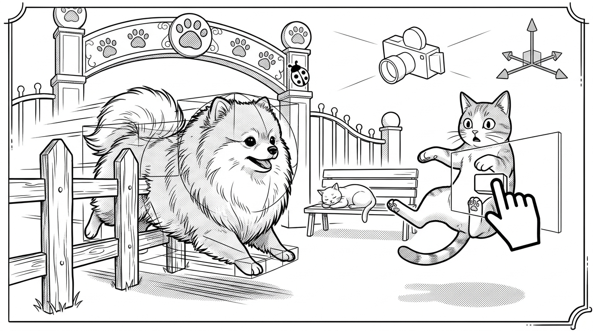

# わくわくアニマルランド（wakuwaku-animal-land）🐾
**〜開園直前なのにバグだらけの動物テーマパークをデバッグせよ！〜**

技術書典21『Unity Sunday Book Vol. 2』収録章 **「新卒1年目の自分に渡したいUnityデバッグ逆引き帖 ―『このバグ、どこから探す？』」** の公式コンパニオン・サンプルプロジェクトです。

---

## 🐶 どんなプロジェクト？（コンセプト）

あなたは動物テーマパーク **『わくわくアニマルランド』** に配属された新卒1年目のエンジニア（飼育員）です。
明日がいよいよ開園日なのに、園内のポメラニアンや猫たちが **Unityの典型的なバグ** に巻き込まれて大混乱しています！

| エリア（シーン） | 登場する動物とバグの例 | 学べるデバッグ技術 |
|---|---|---|
| **第1部：ふれあい広場** （`Part1_NotWorking.unity`） | ・おやつをあげても満腹度が増えない**ポメラニアン**（Prefab誤参照 / Q1） ・1回なでると好感度が2倍になる**ポメラニアン**（胴体＋尻尾の2重コライダー / Q2） ・開園と同時に園長より先に走ってコケる**せっかち猫**（`Awake`/`Start` 順序 / Q3） ・帰宅後（`Destroy`後）の**猫の残像**を追い続けるレーザー（`?.` vs `== null` / Q4） ・透明なガラス看板に邪魔されて押せない「なでる」ボタン（`EventSystem` / Q5） ・全力疾走でドッグランの柵をすり抜けて脱走する**爆速ポメラニアン**（Q6） | `Debug.Log(..., this)`、ブレークポイントとコールスタック、`EventSystem` プレビュー、`Physics Debugger`、`Time.frameCount` ログ、`git bisect` |
| **第2部：アニマルショー会場** （`Part2_Animation.unity`） | ・合図しても毛づくろいが終わるまで跳ばない**マイペース猫**（`Has Exit Time` / Q11） ・空中で指示すると着地した瞬間に芸が暴発する**ポメラニアン**（`Trigger` 居残り / Q12） ・びっくりした最初の1コマ目の顔で凍りつく**フリーズ猫**（`Can Transition To Self` / Q12） ・巨大化ビスケットを食べても大きくならない**ポメラニアン**（Animator上書き / Q13） ・お客さん（Gameカメラ）が見ていないとサボるのに、裏から覗く（Sceneビューを開く）と真面目に踊る**サボり魔の猫**（`Cull Completely` / Q15） | Animator手動パラメータ切り分け、`StateMachineBehaviour` ロガー、`LateUpdate`、Sceneビューカメラのカリング罠 |
| **第3部：大パレード会場** （`Part3_Performance.unity`） | ・30fpsから上がらないパレード（`WaitForTargetFPS` / Q16） ・数秒おきに毛玉（`GC Alloc`）が溜まってカクつく大行進（Q17） ・分身の術（`Instantiate`）とマテリアル複製で重くなる100匹の動物たち（Q18〜Q20） | `Profiler`（CPU Usage / `GC Alloc`）、`ProfilerMarker`（`Self ms`）、`Memory Profiler`、`Frame Debugger` |

---

## 🚀 30秒で動かす手順（Unity 6 / 6000.x）

1. **Unity Hub** でこのフォルダ（`wakuwaku-animal-land`）を開きます。
2. 上部メニューの **`Tools > WakuwakuAnimalLand > Generate All Scenes & Assets`**（または `Tools > BugZoo > Generate All Scenes & Assets`）を1回クリックします。
3. `Assets/BugZoo/Scenes/` に3つのエリア（シーン）が自動生成され、すぐにPlayボタンでバグ再現＆デバッグ練習を始められます！
