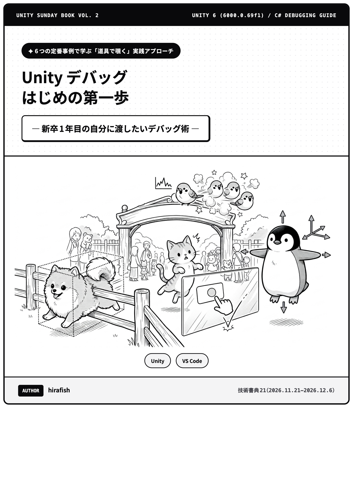

  

# wakuwaku-animal-land（わくわくアニマルランド）

技術書典21『Unity Sunday Book Vol. 2』第6章 **「Unityデバッグ　はじめの第一歩」**（著：hirafish）のサンプルプロジェクトです。

---

## 概要

動物たちのミニゲーム集『わくわくアニマルランド』を題材に、Unity開発でよく遭遇する6つのバグ（Step 1〜6）を再現・調査できるサンプルプロジェクトです。

本プロジェクトでは、各Stepの「バグ状態（BUG）」と「修正状態（FIX）」を画面上のボタンで切り替えながら、**ログ出力・ブレークポイント・条件付きブレークポイント・ウォッチ式・EventSystemプレビュー** などの使い方を手元で確認できます。

> **本誌のサンプルコードとの違いについて**  
> 本誌に掲載されているコードは、問題の本質を直感的に理解できるよう最小限の処理に絞って記載しています。本プロジェクトでは、画面上のボタン1つで「バグ状態」と「修正状態」を切り替えて比較検証できるようにしているため、一部のスクリプトでクラス構成や呼び出し関係が拡張されている場合があります。

| Step番号とテーマ | 対応シーン（`Assets/BugZoo/Steps/` 以下） | バグの内容 |
|---|---|---|
| **Step 1** `Debug.Log` を使ってみよう ― 処理を書いたのに画面が変わらない | `Step01_ScoreNotAdded.unity` `Step01b_InitialValueIgnored.unity` | ProjectのPrefab誤参照（`Debug.Log(..., this)` でPing確認）＆ Inspectorのシーン保存値優先 |
| **Step 2** ブレークポイント（1）処理を止めよう ― コインがなぜか2重に加算される | `Step02_ScoreDoubled.unity` | `Body` と `Feet` の2つのコライダーが両方反応してスコアが2倍になる（コールスタック・引数確認） |
| **Step 3** ブレークポイント（2）条件付きとウォッチ式 ― 倒したはずの敵でエラーが出る | `Step03_MissingTarget.unity` | C#の `_target?.position` がUnityの破棄済み判定（`== null`）をすり抜ける罠（条件付きブレークポイントとウォッチ式） |
| **Step 4** `EventSystem` のプレビューを見よう ― UIのボタンが押せない | `Step04_ButtonBlocked.unity` | 透明な `FadeOverlay` の `Raycast Target` がクリックを吸い込む（`EventSystem` プレビューと `ProbeScreenCenter`） |
| **Step 5** フレーム番号付きログを使ってみよう ― 止めると再現しないバグ | `Step05_RareStateBug.unity` | 同一フレーム内で `Idle -> Attack` が `Attack -> Stun` に上書きされる（`Time.frameCount` ログと `Debug.Break`） |
| **Step 6** `git diff` と `git bisect` を使ってみよう ― 昨日まで動いたのに動かない | なし（Git操作・YAML解説） | YAMLテキスト形式のプレハブ差分特定と `git bisect` による二分探索 |

---

## 動かし方（Unity 6 / 6000.0.69f1）

1. **Unity Hub** でこのフォルダ（`wakuwaku-animal-land`）を開きます。
2. 上部メニューの **`Tools > WakuwakuAnimalLand > Generate All Scenes & Assets`**（または `BugZoo > Setup > All (1〜4を一括実行)`）を1回クリックします。
3. **`Assets/BugZoo/Menu/Menu.unity`** を開いて **Play** を押すと、各Stepのシーンを一覧から選択して動作確認できます。

### 3D動物モデルについて（任意）
ライセンス遵守のため、第三者アセット（3D動物モデル）は本リポジトリに含めていません。
- **そのまま動かす場合**：上記手順2を実行すると、動物モデルの代わりに標準プリミティブ（Cube / Capsule）へ自動で置き換わり、すべてのデバッグ手順がそのまま動作します。
- **本誌と同じ動物モデルを表示したい場合**：Unity Asset Store の無料アセット [**Quirky Series - FREE Animals Pack**](https://assetstore.unity.com/packages/3d/characters/animals/quirky-series-free-animals-pack-178235) をプロジェクトにインポートしたあと、上部メニューの **`Tools > WakuwakuAnimalLand > Generate All Scenes & Assets`** をクリックすると、各シーンに動物モデルが配置されます。

---

## 本章に関連する公式ドキュメント一覧

紙面から直接クリックできない読者のための直通リンク集です。

### Step 1：ログ出力とシリアライズ
- [Debug.Log（第2引数 context によるオブジェクトのハイライト）](https://docs.unity3d.com/6000.0/Documentation/ScriptReference/Debug.Log.html)
- [MonoBehaviour.Awake（Awake と Start の実行順・ライフサイクル）](https://docs.unity3d.com/6000.0/Documentation/ScriptReference/MonoBehaviour.Awake.html)

### Step 2〜3：デバッガ連携とオブジェクト破棄（Fake Null）
- [Managed code debugging（Unity と IDE デバッガの連携）](https://docs.unity3d.com/6000.0/Documentation/Manual/ManagedCodeDebugging.html)
- [Object.Destroy（オブジェクト破棄のタイミングと仕様）](https://docs.unity3d.com/6000.0/Documentation/ScriptReference/Object.Destroy.html)
- [Object.operator ==（UnityEngine.Object 独自の == 演算子オーバーロード）](https://docs.unity3d.com/6000.0/Documentation/ScriptReference/Object-operator_eq.html)

### Step 4：UI（uGUI）の当たり判定調査
- [Event System（uGUI のレイキャスト・イベント伝搬）](https://docs.unity3d.com/Packages/com.unity.ugui@2.0/manual/EventSystem.html)
- [GraphicRaycaster（UIのクリック判定の仕組み）](https://docs.unity3d.com/Packages/com.unity.ugui@2.0/manual/script-GraphicRaycaster.html)
- [CanvasGroup（Interactable / Blocks Raycasts による一括制御）](https://docs.unity3d.com/Packages/com.unity.ugui@2.0/manual/class-CanvasGroup.html)

### Step 5：フレーム計測と一時停止
- [Time.frameCount（経過フレーム番号の取得）](https://docs.unity3d.com/6000.0/Documentation/ScriptReference/Time-frameCount.html)
- [Debug.Break（コードからのエディタ一時停止）](https://docs.unity3d.com/6000.0/Documentation/ScriptReference/Debug.Break.html)

### Step 6：Git による差分調査と二分探索
- [git-diff（コミット間・作業ツリーの差分表示）](https://git-scm.com/docs/git-diff)
- [git-bisect（二分探索によるバグ混入コミットの特定）](https://git-scm.com/docs/git-bisect)

---

## ライセンス

本リポジトリに含まれるサンプルコード（`Assets/BugZoo/` 以下のスクリプト等）は **MIT License** のもとで公開しています。学習やご自身のプロジェクトでのデバッグ用途に、自由にコピー・改変してご利用いただけます。

